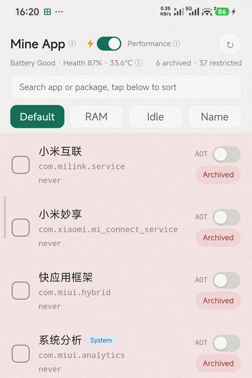
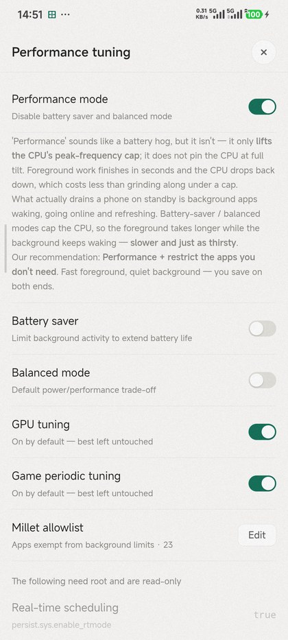
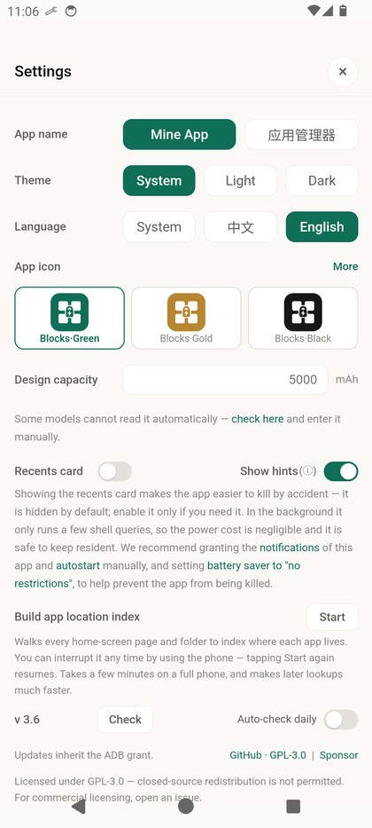

<p align="center">
  <a href="README.md">简体中文</a> · <b>English</b>
</p>

<p align="center">
  
</p>

<h1 align="center">Mine App · App Manager</h1>

<p align="center">
  
  
  
  
  
</p>

> **Mine App is a featherweight Android app manager that brings sluggish devices back to life — without root or heavy frameworks.**
>
> - **Zero Bloat, Zero Dependencies**: No third-party libraries whatsoever — AndroidX included. Built purely on platform APIs: the compiled code is just **33 KB**, the whole APK under 1 MB, and total on-device footprint under 10 MB. No Gradle on the build side either. No root, no resident Shizuku.
> - **Faster and Lighter at Once**: Pair a sustained performance mode with aggressive background freezes and restriction policies. Cut off stealthy background resource grabs to minimize power drain while ensuring maximum foreground responsiveness.
> - **"Performance" mode is not a battery hog**: it only lifts the CPU's peak-frequency cap — it does not pin the CPU at full tilt, and clocks drop back down as soon as foreground work is done. The real standby drain is background wakeups, so we recommend **Performance + Restrict**: faster *and* thriftier than capping the CPU.
> - **Low-Level Acceleration**: Built-in Android AOT Speed batch compilation compiles DEX to native code, eliminating JIT stutters and dramatically accelerating cold-start times on low-spec hardware.

---

## What is this

The usual way to keep an unused app completely silent on Android is to freeze it. Most solutions
require root, or drag in a whole stack of Shizuku / Ice Box / Hail — **several apps that make
already-tight storage even tighter**.

Mine App takes a different route: **single-app deployment, without giving up an ounce of lightness.**

**The phone connects to its own adbd.**

Run `adb tcpip 5555` **once, at install time** — over a USB cable or through Wireless debugging
(see **First-time setup** below). That makes adbd listen on `127.0.0.1:5555`.
The app ships a minimal ADB client, authenticates with a key kept in its private storage, and then
talks to `pm` / `am` / `cmd` directly. That key survives a covering install untouched —
**so updates inherit the authorization automatically, with no need to run `adb` again**.

**One app, and that is the whole setup.** A single 553 KB APK with zero third-party dependencies:
no Shizuku, no Ice Box, no Hail, no resident daemon, no extra permissions.

<p align="center">
  
</p>

### Polling: minimal load, without letting the data go stale

A resident tool is at risk of becoming the very thing it is meant to fix. Mine App splits its
polling into two tiers:

| Frequency | What is fetched | Why split this way |
|---|---|---|
| **Every 3 s** | A single `cat /proc/meminfo` — total and used memory | So cheap it is effectively free, yet enough to keep the memory picture live |
| **Every 60 s** | Battery health, archive count, restriction count | These only change about once a minute, and cost `dumpsys battery` + `dumpsys batterystats` + four `pm`/`appops` calls — far heavier than meminfo, so only once a minute |

There is also a **manual refresh button**, for when you want the state right now instead of waiting
for the next tick.

In short: **poll the lightest metric often, do the heavy work rarely** — minimal load on the device,
with information that never goes stale.

**After that the PC is out of the picture** — freezing, restricting, AOT compilation and performance
profiles are all a few taps on the phone, with no adb tooling involved. As long as you do not reboot,
that single `adb tcpip` keeps working; after a reboot, just run it once more.

### Compared to the usual options

| | **Mine App** | Built-in "Force stop" | Ice Box | Hail |
|---|---|---|---|---|
| Needs root | **No** | No | No | No |
| Requires Shizuku | **No ✓** | No | Yes | Yes |
| Ships its own ADB client | **Yes ✓** | — | No (uses Shizuku) | No (uses Shizuku) |
| Needs a background daemon | **No ✓** | No | Yes (Shizuku running) | Yes (Shizuku running) |
| APK size | **< 1MB ✓** | Built in | Several MB | Several MB |
| Batch freeze / unfreeze | **Yes** | — | Yes | Yes |
| Survives a reboot | **Yes** | No | Yes | Yes |
| Performance profile tuning | **Yes ✓** | — | — | — |
| Per-app AOT compilation | **Yes ✓** | — | — | — |
| PSS memory sorting | **Yes ✓** | — | — | — |

> **✓** marks where Mine App has the edge.
> "Ships its own ADB client" means the app implements the ADB protocol itself (CNXN / AUTH / OPEN /
> WRTE) and talks straight to the phone's local adbd — so no Shizuku or other external tool is
> needed, and it runs standalone after a one-time authorization.
> The Ice Box / Hail columns are based on their public documentation and common usage;
> refer to their own docs for details.

## Features

| Feature | What it does |
|---|---|
| **Archive (freeze)** | `pm disable-user` — the app never runs, disappears from recents, and its **launcher icon disappears entirely** (MIUI / HyperOS doesn't render a greyed-out state) |
| **Restrict** | `appops RUN_IN_BACKGROUND` — restricts background activity; milder than freezing, the app can still be launched |
| **App finder** (new in 3.8) | Tap the locate button on any row and it jumps straight to that app's home-screen page and opens the folder — find any app no matter how many you have. The index only needs building once; if there is none yet, or it is incomplete, a hint above the list takes you to Settings to build it |
| **Allowlist (exempt)** | Adds an app to the system doze / standby allowlist (`MILLET_NO_RESTRICT_APP`), so the OS stops throttling it as "unused". **Note this is not the same as MIUI's *Battery saver → No restrictions*** — that toggle is separate state kept by `com.miui.powerkeeper`, cannot be written through `settings`, and has to be set on the app-info page. Allowlisted apps get a pill and sort to the top; the footer totals the PSS of everything you have ticked |
| **AOT compile** | `cmd package compile -m speed` — pre-compiles dex to native code for faster cold starts; **per-app or in bulk**, with a live elapsed-time readout while compiling. **State is auto-detected**: after a reinstall or data wipe it reads back which apps are already AOT-compiled from `dumpsys package dexopt`, so the UI shows the truth instead of starting from zero |
| **Performance profile tuning** | One-tap system performance governor, automatically re-applied if the ROM reverts it |
| **Memory sort** | Sort by PSS to see exactly what is eating RAM; the footer shows live system-wide memory usage |
| **Activity monitor** | A **pulsing green dot** on the memory line marks apps that are actually running (based on the system's oom adj — plain cached processes and "recently used, now in background" do not count) |
| **Per-app cleanup** | An **×** on every row runs `am kill` — clears background processes only. **Auto-start and enabled state are untouched**, so the next launch is a normal cold start. It also reports how much memory was actually freed |
| **Real app names** | Resolved in two passes — launcher-activity labels, then application labels — so every installed app shows its real name instead of its package name |
| **Batch actions** | Select many apps, then archive / restore / restrict / unrestrict in one go |
| **Ongoing notification** | Battery health, memory usage and archive count in the status bar; memory ticks every 3 s, battery/counts every 60 s — barely any battery cost |
| **Appearance** | 6 icon sets (blocks / clover × green / gold / black), two app names, light & dark theme, Chinese & English |
| **List cache** | The fetched list is cached locally; re-entering within a minute does not refetch |

> **"Restrict" and "Allowlist" are two independent switches — don't conflate them:**
>
> | | What it changes | Effect |
> |---|---|---|
> | **Restrict** | `appops RUN_IN_BACKGROUND` | The app's background-activity permission |
> | **Allowlist** | The system power-management list (doze whitelist / `standby bucket = EXEMPTED`) | Whether the system throttles it in the background |
>
> They don't override each other, so **an app can be both Restricted and Allowlisted**.
>
> Verified on device: all 22 allowlisted apps report `standby bucket = 5 (EXEMPTED)` and appear in
> `dumpsys deviceidle whitelist`; sampled apps outside the list do not. In other words, the in-app
>
> ⚠️ They are not the same thing: the Millet allowlist governs the **framework-level standby bucket /
> doze exemption**, while the *Battery saver* toggle in MIUI's UI is separate state kept by
> `com.miui.powerkeeper` and cannot be written through `settings`. To make the system UI show
> "No restrictions", pick it once on the app-info page.

> **On "Performance" mode: it is not actually a battery hog**
>
> It sounds like one, but the opposite is true — it only **lifts the CPU's peak-frequency cap**;
> it does not pin the CPU at full tilt. The CPU is demand-driven: foreground work finishes in
> seconds and drops back to low clocks, which costs less than grinding along under a cap.
>
> What really drains a phone on standby is **background apps waking, going online and refreshing** —
> not peak frequency. Traditional battery-saver / balanced modes cap the CPU, so the foreground
> takes longer to do the same work while the background keeps waking: **slower and just as thirsty**.
>
> So the recommendation is a combination:
>
> | Action | What it does |
> |---|---|
> | Turn on **Performance** | Lifts the CPU cap, so foreground work finishes and exits quickly |
> | **Restrict** the apps you don't need | Puts the background to sleep and removes the wakeups |
>
> Fast foreground, quiet background — you save on both ends.

<p align="center">
  
</p>

<p align="center">
  
</p>

<p align="center">
  
</p>

<p align="center">
  <sub>Customisable icons: six built-in sets (square / clover × green / gold / black), switchable
  together with the app name from Settings — the first three show by default, "More" reveals the rest.<br>
  More will be added over time — pull requests with licence-compliant icons are welcome.</sub>
</p>

## Requirements

- Android 8.0 (API 26) or newer, targetSdk 35
- Developer options → **USB debugging** enabled
- No root

## Install

1. Grab `app-manager.apk` (~553 KB) from [Releases](https://github.com/henry-97/MineApp/releases)
2. Or build it yourself (see below)

### First-time setup (once only)

The app talks to the adbd listening on **port 5555 of the same device**, so adbd has to be told to
listen on TCP. Do this **once, at install time** — after that it is all taps inside the app, with no
PC involved, for as long as the phone stays booted.

#### Path A — let an AI agent do it (zero-friction, best for beginners)

You don't need to know adb, and you don't type any commands — do the phone-side prep, then hand the
rest to any AI agent (ChatGPT / Claude / Gemini / Cursor — whatever you use).

**Step 1 — enable Developer options and USB debugging on the phone**

1. Settings → About phone → tap **"OS version" seven times** until it says developer mode is enabled
2. Back out → Additional settings → **Developer options** → turn on **USB debugging**
3. Plug into the computer; when the phone asks "Allow USB debugging?", tick
   **"Always allow from this computer"** → OK

**Step 2 — paste this into your AI agent**

> Install and set up Mine App (an Android app manager) on this computer for me.
> Project: <https://github.com/henry-97/MineApp>
>
> Read the "First-time setup" section of the README first, then do the following in order:
> ① confirm `adb devices` lists my phone (install platform-tools first if adb is missing; if the command is still not found afterwards, use the full path or add it to PATH as described under "Make sure `adb` works");
> ② run `adb tcpip 5555`;
> ③ download the latest APK from Releases and `adb install -r` it;
> ④ open the app on my phone and prompt me to tap "Allow" if an ADB authorisation dialog appears;
> ⑤ confirm the app can list my installed apps.
>
> Explain what you're about to do before each step; if something fails, diagnose it rather than asking
> me to type commands.

The agent downloads platform-tools, runs adb and installs the APK. All you tap is "Allow", twice.

**Path B / C: manual install is easy too — once `adb` is set up it comes down to a single command, `adb tcpip 5555`.**

#### Make sure `adb` works (both Path B and C need this)

**Case 1: `adb devices` lists your device** → run this one command and you're done:

```bash
adb tcpip 5555
```

Unplug → open the app → tick "Always allow" → Allow.

> Want to walk through it yourself, or have no cable? See **Path B** (USB) and **Path C**
> (wireless debugging) below for the full flow. You can also hand the whole thing to an
> AI agent (**Path A**).

**Case 2: `'adb' is not recognized` / `command not found`** → not installed, or not on PATH.
Fix it with the steps below, then come back and run the command above.

**Not installed**: download [platform-tools](https://developer.android.com/tools/releases/platform-tools)
and extract it to a fixed folder — `C:\platform-tools` on Windows, `~/platform-tools` on macOS / Linux.

**Installed but still not found**, add it to PATH:

```powershell
# Windows PowerShell — current window only, gone once you close it
$env:Path += ";C:\platform-tools"
adb devices
```

```bash
# macOS / Linux
export PATH="$HOME/platform-tools:$PATH"
adb devices
```

To make it permanent (Windows, current user only — does not touch the system PATH):

```powershell
[Environment]::SetEnvironmentVariable("Path",
  [Environment]::GetEnvironmentVariable("Path","User") + ";C:\platform-tools", "User")
```

> You must **close and reopen the terminal** afterwards — already-open windows keep the old PATH.
> On macOS / Linux, add the `export` line to `~/.zshrc` or `~/.bashrc`.

**Don't want to touch PATH?** Call it by full path instead (the leading `&` is required on Windows):

```powershell
& "C:\platform-tools\adb.exe" tcpip 5555
```

```bash
~/platform-tools/adb tcpip 5555
```

#### Path B — you have a USB cable (type one command yourself)

```bash
# 1. Plug the phone into a PC
adb tcpip 5555

# 2. Unplug. Open the app; the phone shows the ADB dialog → tick "Always allow" → Allow
```

Done.

#### Path C — no cable (borrow the PC's Wireless debugging to run that one command)

Phone and PC on the **same Wi-Fi**:

```bash
# 1. Phone: Settings → Developer options → Wireless debugging → "Pair device with pairing code"
#    The screen shows an IP, a pairing port, and a 6-digit code

# 2. PC: pair first (this is the PAIRING port, not the debug port)
adb pair 192.168.1.23:37123
#    Enter the 6-digit code when prompted

# 3. PC: connect (this time the DEBUG port — it differs from the pairing port)
adb connect 192.168.1.23:40555

# 4. PC: the one command that matters
adb tcpip 5555

# 5. You can now turn Wireless debugging off — the app does not need it either way
```

Then open the app and tick "Always allow" on the phone.

> **Why not connect to Wireless debugging directly?** It is technically possible and would remove
> the PC entirely — but it means rewriting the whole pairing and TLS transport layer, and the added
> component would be larger than the app itself, with real multi-device compatibility risk. That
> contradicts the whole point of staying featherweight, and it offers no clear advantage over running
> one `adb` command at setup time. So this approach is deliberately not pursued for now.

#### After a reboot

Port 5555 closes (`adb tcpip` does not survive a reboot, and `persist.adb.tcp.port` cannot be written
without root). **Repeat either path above.** The app shows "ADB channel not connected" and reminds you
of the command.

## Build from source

No Gradle, no Android Studio — just JDK + Android SDK build-tools + python3:

```bash
git clone https://github.com/henry-97/MineApp.git
cd MineApp/appmanager

cp local.env.example local.env     # point it at your SDK / JDK
bash build.sh                      # output: out/app-manager.apk
```

You need:

- JDK 17
- Android SDK: `build-tools;35.0.0`, `platforms;android-35`
- Python 3 + Pillow (for icon generation)

`build.sh` generates a self-signed key on first run, so there is nothing to prepare.
Every path can be overridden via environment variables — see the header of `build.sh`.

> An APK you build yourself is signed with a different key and **cannot be installed over** the
> official release — uninstall first. Conversely, nobody can ship an update over the official
> release either. That is exactly what a release key is for.

## Project layout

```
MineApp/
├── appmanager/                   Android project (no Gradle)
│   ├── build.sh                  aapt2 → javac → d8 → zipalign → apksigner
│   ├── src/java/.../
│   │   ├── AdbClient.java        ADB protocol (CNXN/AUTH/OPEN/WRTE/OKAY/CLSE)
│   │   ├── AdbService.java       Business layer: list, freeze, restrict, AOT, battery, memory
│   │   ├── Bridge.java           JS ↔ Java bridge, two pools (normal / long-running)
│   │   ├── MainActivity.java     WebView host
│   │   └── KeepAliveService.java Ongoing notification
│   ├── res/                      Resources (icons generated by tools/gen_icon.py)
│   ├── assets/                   Front-end bundled into the APK
│   └── tools/
│       ├── gen_assets.py         Extracts the UI from server.py + package name map
│       ├── gen_icon.py           Generates the 6 adaptive icon sets
│       └── gen_manifest.py       Generates the 12 activity-aliases
└── termux/
    └── webui/server.py           Single source of truth for the UI (also the Termux server)
```

**There is only one copy of the front-end.** `server.py` embeds the whole HTML/CSS/JS;
`gen_assets.py` extracts it verbatim and injects a `fetch → Java bridge` shim. The Termux build and
the APK therefore share identical UI logic — no second implementation to keep in sync.

## Known limitations

- **Port 5555 closes on reboot.** Run `adb tcpip 5555` once more.
  `persist.adb.tcp.port` cannot be written without root (SELinux blocks the shell user), so there is
  no way to make it survive a reboot.
- **Full AOT compilation is memory-hungry.** dex2oat can peak above 2 GB, so the app refuses to start
  below ~2.5 GB of free memory and tells you why. A few very large apps (many plugin dex files, e.g.
  TikTok Lite) may be abandoned by dex2oat even with plenty of RAM, leaving the status at `speed-profile`.
- After archiving, the **launcher icon disappears entirely** (MIUI / HyperOS doesn't show a
  greyed-out disabled state). That's system behaviour, not an uninstall — tap "Restore" in the
  app and it returns to its original spot.

- **Never approve an unexpected "Allow USB debugging?" dialog on a public network.**
  `adb tcpip 5555` makes adbd listen on all interfaces, so anyone on the same network can trigger
  that dialog; tapping Allow hands them control of your phone and can leak your data. Deny anything
  you did not initiate.

<a id="sponsor"></a>

## Sponsorship

If this project helped you, you can buy me a coffee. **Entirely optional — no feature is gated.**

**Preferred: [GitHub Sponsors](https://github.com/sponsors/henry-97)** — monthly or one-off,
publicly recorded, and easy for me to thank you properly.

Or scan directly:

<div align="center">
  <table>
    <tr>
      <td align="center"><b>WeChat Pay</b></td>
      <td align="center"><b>Alipay</b></td>
    </tr>
    <tr>
      <td></td>
      <td></td>
    </tr>
  </table>
</div>

Issues and pull requests are just as welcome — they help a lot too.

## License

[GPL-3.0](LICENSE).

Use it, modify it, redistribute it — but **derivatives must stay open source; repackaging it with ads
and shipping it closed-source is strictly prohibited**. If you need it inside a proprietary product,
open an issue to discuss a licence.

## Usage notes

This app drives the system `pm` / `am` / `cmd` commands directly through ADB — it is **genuinely powerful**.

**Do not freeze or restrict components the system depends on** (Clock, the launcher, the keyboard,
Phone / Messaging, …). Doing so can stop alarms, break the home screen, block incoming calls, and more.

If you lock yourself out and the app can no longer be opened, connect the phone to a PC and run:

```bash
adb shell pm enable <package>
```

That re-enables the component and gets you back in.

**The author is not liable for data loss or device misbehaviour caused by misuse.**
