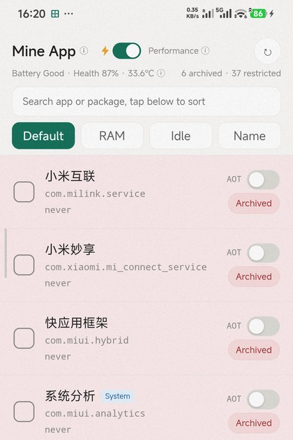
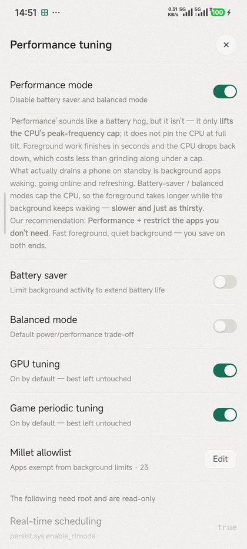
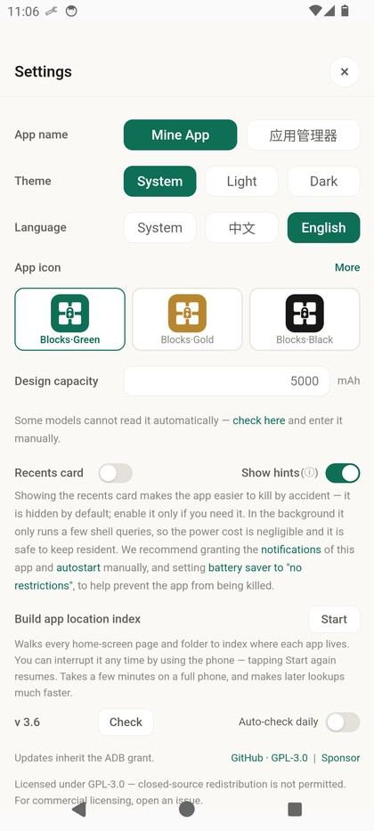
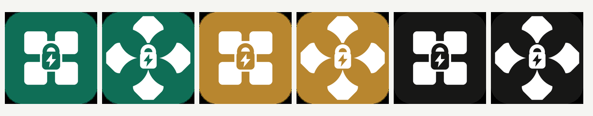

<p align="center">
  <a href="README.md">简体中文</a> · <b>English</b>
</p>

<p align="center">
  
</p>

<h1 align="center">Mine App · App Manager</h1>

<p align="center">
  
  
  
  
  
</p>

> **Mine App is a featherweight Android app manager that brings sluggish devices back to life — without root or heavy frameworks.**
>
> - **Zero Bloat, Zero Dependencies**: No third-party libraries whatsoever — AndroidX included. Built purely on platform APIs: the compiled code is just **33 KB**, the whole APK under 1 MB, and total on-device footprint under 10 MB. No Gradle on the build side either. No root, no resident Shizuku.
> - **Restrictions survive a reboot**: **set it once, and it's permanent**. Archive and restrict are written into system state, so they **stay in effect after the phone reboots** — nothing to re-apply. If you reboot and haven't re-authorised adb yet, the only consequence is that the app can't refresh its list for now; apps you already restricted or archived don't get released. Re-authorise whenever it suits you — rebooting often is nothing to worry about.
> - **Faster and Lighter at Once**: Pair a sustained performance mode with aggressive background freezes and restriction policies. Cut off stealthy background resource grabs to minimize power drain while ensuring maximum foreground responsiveness.
> - **"Performance" mode is not a battery hog**: it only lifts the CPU's peak-frequency cap — it does not pin the CPU at full tilt, and clocks drop back down as soon as foreground work is done. The real standby drain is background wakeups, so we recommend **Performance + Restrict**: faster *and* thriftier than capping the CPU.
> - **Low-Level Acceleration**: Built-in Android AOT Speed batch compilation compiles DEX to native code, eliminating JIT stutters and dramatically accelerating cold-start times on low-spec hardware.

---

## What is this

The usual way to keep an unused app completely silent on Android is to freeze it. Most solutions
require root, or drag in a whole stack of Shizuku / Ice Box / Hail — **several apps that make
already-tight storage even tighter**.

Mine App takes a different route: **single-app deployment, without giving up an ounce of lightness.**

**The phone connects to its own adbd.**

Run `adb tcpip 5555` **once, at install time** — over a USB cable or through Wireless debugging
(see **First-time setup** below). That makes adbd listen on `127.0.0.1:5555`.
The app ships a minimal ADB client, authenticates with a key kept in its private storage, and then
talks to `pm` / `am` / `cmd` directly. That key survives a covering install untouched —
**so updates inherit the authorization automatically, with no need to run `adb` again**.

**After that the PC is out of the picture** — freezing, restricting, AOT compilation and performance
profiles are all a few taps on the phone, with no adb tooling involved. As long as you do not reboot,
that single `adb tcpip` keeps working. After a reboot, every restriction stays in effect even before
you re-authorise — you just cannot refresh the app list until you run it once more at your convenience,
**so rebooting often is nothing to worry about**.

**One app, and that is the whole setup.** A single 648 KB APK with zero third-party dependencies:
no Shizuku, no Ice Box, no Hail, no third-party daemon, no extra permissions — just one ongoing notification that shows battery and memory.

<p align="center">
  
</p>

### Polling: minimal load, without letting the data go stale

A resident tool is at risk of becoming the very thing it is meant to fix. Mine App's rule is
**use a system API instead of a shell command, and run it as rarely as the data allows**:

| Frequency | What is fetched | How |
|---|---|---|
| **Every 3 s while the screen is on / every 60 s while off** | Memory usage | `ActivityManager.MemoryInfo` — **no shell command at all** |
| **Every 3 min while the screen is on / every 30 min while off** | Battery health, archive count, restriction count, **tombstone re-assert** | `dumpsys battery` + `dumpsys batterystats` + four `pm` / `appops` calls + one `ps` + batched `am set-inactive` |

Four notes:

- **Memory no longer goes through a shell.** Earlier builds ran `cat /proc/meminfo` every 3 s — over
  Shizuku / ADB that means forking a process every 3 s, which was the single biggest standby drain.
  It now reads the same numbers from the system API, with zero process overhead.
- **Frequency follows the screen, not the foreground state.** As long as the screen is on you may pull
  down the notification shade at any moment, so memory refreshes every 3 s whether the app is in front
  or not. When the screen is off nobody can see it, so it drops to 60 s. Turning the screen back on
  triggers an immediate refresh — you never see a stale number.
- **Heavy work stays rare.** Battery health and archive/restriction counts need `dumpsys` and `pm`,
  so they run every 3 minutes on-screen and every 30 minutes off-screen.
- **The tombstone re-assert rides the full refresh.** `setAppInactive` is cleared automatically when
  you launch an app — one launch and the restriction silently stops working. So every full refresh
  re-marks each **restricted app that currently has a process**. Typically around 40 packages, batched
  into a single shell call, roughly 2 s. Packages with no running process are skipped (running the
  command on them is pure waste). There is **no separate timer** here — change `FULL_GAP` and this
  follows automatically.

Turning the screen back on also refreshes immediately, so you will never be looking at pre-sleep numbers.

There is also a **manual refresh button**: besides reloading the list, it forces an immediate full
refresh of the notification's battery / archive / restriction figures, so you never wait for the
timer.

In short: **poll the lightest metric often, do the heavy work rarely, and do almost nothing with the
screen off.**

### Compared to the usual options

| | **Mine App** | Built-in "Force stop" | Ice Box | Hail |
|---|---|---|---|---|
| Needs root | **No** | No | No | No |
| Requires Shizuku | **No ✓** | No | Yes | Yes |
| Ships its own ADB client | **Yes ✓** | — | No (uses Shizuku) | No (uses Shizuku) |
| Needs a background daemon | **Notification only ✓** | No | Yes (Shizuku running) | Yes (Shizuku running) |
| APK size | **< 1MB ✓** | Built in | Several MB | Several MB |
| Batch freeze / unfreeze | **Yes** | — | Yes | Yes |
| Survives a reboot | **Yes** | No | Yes | Yes |
| Performance profile tuning | **Yes ✓** | — | — | — |
| Per-app AOT compilation | **Yes ✓** | — | — | — |
| PSS memory sorting | **Yes ✓** | — | — | — |
| Per-process details (CPU / memory / oom) | **Yes ✓** | — | — | — |

> **✓** marks where Mine App has the edge.
> "Ships its own ADB client" means the app implements the ADB protocol itself (CNXN / AUTH / OPEN /
> WRTE) and talks straight to the phone's local adbd — so no Shizuku or other external tool is
> needed, and it runs standalone after a one-time authorization.
> The Ice Box / Hail columns are based on their public documentation and common usage;
> refer to their own docs for details.

## Features

| Feature | What it does |
|---|---|
| **Archive (freeze)** | `pm disable-user` — the app never runs, disappears from recents, and its **launcher icon disappears entirely** (MIUI / HyperOS doesn't render a greyed-out state) |
| **Restrict** | `am set-inactive` (tombstone) freezes background processes, and also blocks the app from **starting foreground services** (`START_FOREGROUND`) and **holding wake locks** (`WAKE_LOCK`) — many apps hide behind "I'm a foreground service" to survive background cleanup, so closing that path is what makes the tombstone stick. Opening the app resumes **the same process**. Milder than archiving: it still launches and keeps its icon. Some high-privilege apps may keep a few processes — see Known limitations |
| **Process details** (5.0) | `Nprocs ›` after the timestamp; tap it to see each process: sub-process name, cumulative CPU time, memory, system oom level, and which ones are still active. Processes in a dual-app / cloned profile are tagged `·dual`. **Queried only on expand — never polled in the background** |
| **App finder** (since 3.8) | Tap the locate button on any row and it jumps straight to that app's home-screen page and opens the folder — find any app no matter how many you have. The index only needs building once; if there is none yet, or it is incomplete, a hint above the list takes you to Settings to build it |
| **Allowlist (exempt)** | Adds an app to the system doze / standby allowlist (`MILLET_NO_RESTRICT_APP`), so the OS stops throttling it as "unused". **Note this is not the same as MIUI's *Battery saver → No restrictions*** — that toggle is separate state kept by `com.miui.powerkeeper`, cannot be written through `settings`, and has to be set on the app-info page. Allowlisted apps get a pill and sort to the top; the footer totals the PSS of everything you have ticked |
| **AOT compile** | `cmd package compile -m speed` — pre-compiles dex to native code for faster cold starts; **per-app or in bulk**, with a live elapsed-time readout while compiling. **State is auto-detected**: after a reinstall or data wipe it reads back which apps are already AOT-compiled from `dumpsys package dexopt`, so the UI shows the truth instead of starting from zero |
| **Performance profile tuning** | One-tap system performance governor, automatically re-applied if the ROM reverts it |
| **Memory sort** | Sort by PSS to see exactly what is eating RAM; the footer shows live system-wide memory usage |
| **Activity monitor** | A **pulsing green dot** on the memory line marks apps that are actually running (based on the system's oom adj — only pure cached processes are excluded) |
| **Per-app cleanup** | An **×** on every row runs `am force-stop`, stopping **every** process of that app and clearing its recents card too (`am stack remove`). The label clears instantly, the row leaves the list after 0.8 s, and the kill runs asynchronously in the background |
| **Real app names** | Resolved in two passes — launcher-activity labels, then application labels — so every installed app shows its real name instead of its package name |
| **Batch actions** | Select many apps, then archive / restore / restrict / unrestrict in one go |
| **Ongoing notification** | Battery health, memory usage and archive count in the status bar; memory reads a system API (no shell) every 3 s while the screen is on and 60 s while off, battery/counts every 3 min / 30 min — almost no standby cost |
| **Appearance** | 6 icon sets (blocks / clover × green / gold / black), two app names, light & dark theme, Chinese & English |
| **List cache** | The fetched list is cached locally; re-entering within a minute does not refetch |

> **Three things that are easy to mix up — one table:**
>
> | Where you touch it | What it actually changes | Which layer it governs |
> |---|---|---|
> | This app → **Restrict** | `am set-inactive` (tombstone), plus `appops` as a marker only | Background processes get frozen; foreground use is unaffected and opening the app unfreezes it |
> | This app → **Allowlist** | The system doze / standby allowlist (`EXEMPTED`) | Whether the system throttles it |
> | MIUI Settings → **Battery saver** | Private state kept by `com.miui.powerkeeper` | MIUI's own power logic |
>
> The first two are independent states and can coexist (an app can be both Restricted and
> Allowlisted). They pull in opposite directions though — **the allowlist loosens, Restrict
> tightens** — so if you want something running in the background, don't restrict it.
>
> The third one we cannot write — to make MIUI's UI show "No restrictions", pick it once on the
> app-info page.

> **Why does a process show more memory than the whole app?**
>
> The number in the list is **PSS**; the number in the process rows is **RSS**. They treat shared
> libraries differently:
>
> | Metric | How shared libraries count | The question it answers |
> |---|---|---|
> | **PSS** (app row) | **Split** across the processes using it | How much physical memory this app really accounts for |
> | **RSS** (process row) | **Full size for every** process | How many physical pages this process maps |
>
> Example: a 200 MB shared library used by 10 processes is counted as 200 MB in every process's RSS,
> but only 20 MB in PSS. So **a single process's RSS can exceed the app's total PSS — even for a
> single-process app**. Both numbers are correct, they just answer different questions: use PSS (the
> list) to compare apps, use RSS to see how much a specific process touches.

> **On "Performance" mode: it is not actually a battery hog**
>
> It sounds like one, but the opposite is true — it only **lifts the CPU's peak-frequency cap**;
> it does not pin the CPU at full tilt. The CPU is demand-driven: foreground work finishes in
> seconds and drops back to low clocks, which costs less than grinding along under a cap.
>
> What really drains a phone on standby is **background apps waking, going online and refreshing** —
> not peak frequency. Traditional battery-saver / balanced modes cap the CPU, so the foreground
> takes longer to do the same work while the background keeps waking: **slower and just as thirsty**.
>
> So the recommendation is a combination:
>
> | Action | What it does |
> |---|---|
> | Turn on **Performance** | Lifts the CPU cap, so foreground work finishes and exits quickly |
> | **Restrict** the apps you don't need | Puts the background to sleep and removes the wakeups |
>
> Fast foreground, quiet background — you save on both ends.

<p align="center">
  
</p>

<p align="center">
  
</p>

<p align="center">
  
</p>

<p align="center">
  <sub>Customisable icons: six built-in sets (square / clover × green / gold / black), switchable
  together with the app name from Settings — the first three show by default, "More" reveals the rest.<br>
  More will be added over time — pull requests with licence-compliant icons are welcome.</sub>
</p>

## Requirements

- Android 8.0 (API 26) or newer, targetSdk 35
- Developer options → **USB debugging** enabled
- No root

## Install

1. Grab the right APK (~650 KB) from [Releases](https://github.com/henry-97/MineApp/releases):
   standard `MineApp-X.Y.apk` or multi-channel `MineApp-X.Y-multi.apk` — see "Extended edition" below for the difference
2. Or build it yourself (see below)

### First-time setup (once only)

The app talks to the adbd listening on **port 5555 of the same device** (a custom port is also
supported), so adbd has to be told to listen on TCP. Do this **once, at install time** — after that
it is all taps inside the app, with no PC involved.

**Configure once, permanent effect**: every archive and restriction you set in the app is written into
system state and **survives a reboot**. A reboot only means the list can't be read for now and no new
restrictions can be applied — apps you already restricted or archived keep their state.

#### Path A — let an AI agent do it (zero-friction, best for beginners)

You don't need to know adb, and you don't type any commands — do the phone-side prep, then hand the
rest to any AI agent (ChatGPT / Claude / Gemini / Cursor — whatever you use).

**Step 1 — enable Developer options and USB debugging on the phone**

1. Settings → About phone → tap **"OS version" seven times** until it says developer mode is enabled
2. Back out → Additional settings → **Developer options** → turn on **USB debugging**
3. Plug into the computer; when the phone asks "Allow USB debugging?", tick
   **"Always allow from this computer"** → OK

**Step 2 — paste this into your AI agent**

> Install and set up Mine App (an Android app manager) on this computer for me.
> Project: <https://github.com/henry-97/MineApp>
>
> Read the "First-time setup" section of the README first, then do the following in order:
> ① confirm `adb devices` lists my phone (install platform-tools first if adb is missing; if the command is still not found afterwards, use the full path or add it to PATH as described under "Make sure `adb` works");
> ② run `adb tcpip 5555`;
> ③ download the latest APK from Releases and `adb install -r` it;
> ④ open the app on my phone and prompt me to tap "Allow" if an ADB authorisation dialog appears;
> ⑤ confirm the app can list my installed apps.
>
> Explain what you're about to do before each step; if something fails, diagnose it rather than asking
> me to type commands.

The agent downloads platform-tools, runs adb and installs the APK. All you tap is "Allow", twice.

**Path B / C: manual install is easy too — once `adb` is set up it comes down to a single command, `adb tcpip 5555`.**

#### Make sure `adb` works (both Path B and C need this)

**Case 1: `adb devices` lists your device** → run this one command and you're done:

```bash
adb tcpip 5555
```

Unplug → open the app → tick "Always allow" → Allow.

> Want to walk through it yourself, or have no cable? See **Path B** (USB) and **Path C**
> (wireless debugging) below for the full flow. You can also hand the whole thing to an
> AI agent (**Path A**).

**Case 2: `'adb' is not recognized` / `command not found`** → not installed, or not on PATH.
Fix it with the steps below, then come back and run the command above.

**Not installed**: download [platform-tools](https://developer.android.com/tools/releases/platform-tools)
and extract it to a fixed folder — `C:\platform-tools` on Windows, `~/platform-tools` on macOS / Linux.

**Installed but still not found**, add it to PATH:

```powershell
# Windows PowerShell — current window only, gone once you close it
$env:Path += ";C:\platform-tools"
adb devices
```

```bash
# macOS / Linux
export PATH="$HOME/platform-tools:$PATH"
adb devices
```

To make it permanent (Windows, current user only — does not touch the system PATH):

```powershell
[Environment]::SetEnvironmentVariable("Path",
  [Environment]::GetEnvironmentVariable("Path","User") + ";C:\platform-tools", "User")
```

> You must **close and reopen the terminal** afterwards — already-open windows keep the old PATH.
> On macOS / Linux, add the `export` line to `~/.zshrc` or `~/.bashrc`.

**Don't want to touch PATH?** Call it by full path instead (the leading `&` is required on Windows):

```powershell
& "C:\platform-tools\adb.exe" tcpip 5555
```

```bash
~/platform-tools/adb tcpip 5555
```

#### Path B — you have a USB cable (type one command yourself)

```bash
# 1. Plug the phone into a PC
adb tcpip 5555

# 2. Unplug. Open the app; the phone shows the ADB dialog → tick "Always allow" → Allow
```

Done.

#### Path C — no cable (borrow the PC's Wireless debugging to run that one command)

Phone and PC on the **same Wi-Fi**:

```bash
# 1. Phone: Settings → Developer options → Wireless debugging → "Pair device with pairing code"
#    The screen shows an IP, a pairing port, and a 6-digit code

# 2. PC: pair first (this is the PAIRING port, not the debug port)
adb pair 192.168.1.23:37123
#    Enter the 6-digit code when prompted

# 3. PC: connect (this time the DEBUG port — it differs from the pairing port)
adb connect 192.168.1.23:40555

# 4. PC: the one command that matters
adb tcpip 5555

# 5. You can now turn Wireless debugging off — the app does not need it either way
```

Then open the app and tick "Always allow" on the phone.

> **Why not connect to Wireless debugging directly?** It is technically possible and would remove
> the PC entirely — but it means rewriting the whole pairing and TLS transport layer, and the added
> component would be larger than the app itself, with real multi-device compatibility risk. That
> contradicts the whole point of staying featherweight, and it offers no clear advantage over running
> one `adb` command at setup time. So this approach is deliberately not pursued for now.

#### After a reboot

Port 5555 closes (`adb tcpip` does not survive a reboot, and `persist.adb.tcp.port` cannot be written
without root). **Repeat either path above.** The app shows "ADB channel not connected" and reminds you
of the command.

**But the restrictions and archives you already set are permanent**: they live in system state, so one
reboot or ten makes no difference. Only the "read the list" channel is down — no rush to redo it, do it
whenever convenient.

## Build from source

No Gradle, no Android Studio — just JDK + Android SDK build-tools + python3:

```bash
git clone https://github.com/henry-97/MineApp.git
cd MineApp/appmanager

cp local.env.example local.env     # point it at your SDK / JDK
bash build.sh                      # output: out/app-manager.apk
```

You need:

- JDK 17
- Android SDK: `build-tools;35.0.0`, `platforms;android-35`
- Python 3 + Pillow (for icon generation)

`build.sh` generates a self-signed key on first run, so there is nothing to prepare.
Every path can be overridden via environment variables — see the header of `build.sh`.

> An APK you build yourself is signed with a different key and **cannot be installed over** the
> official release — uninstall first. Conversely, nobody can ship an update over the official
> release either. That is exactly what a release key is for.

## Project layout

```
MineApp/
├── appmanager/                   Android project (no Gradle)
│   ├── build.sh                  aapt2 → javac → d8 → zipalign → apksigner
│   ├── src/java/.../
│   │   ├── AdbClient.java        ADB protocol (CNXN/AUTH/OPEN/WRTE/OKAY/CLSE)
│   │   ├── AdbService.java       Business layer: list, freeze, restrict, AOT, battery, memory
│   │   ├── A11yService.java      Accessibility service: home-screen index / app finder
│   │   ├── Bridge.java           JS ↔ Java bridge, two pools (normal / long-running)
│   │   ├── MainActivity.java     WebView host
│   │   ├── OpHistory.java        Operation history (archive / restore / restrict / unrestrict)
│   │   └── KeepAliveService.java Ongoing notification + tombstone re-assert
│   ├── res/                      Resources (icons generated by tools/gen_icon.py)
│   ├── assets/                   Front-end bundled into the APK (generated, don't edit)
│   └── tools/
│       ├── gen_assets.py         Extracts the UI from the source file + package name map
│       ├── gen_icon.py           Generates the 6 adaptive icon sets
│       └── gen_manifest.py       Generates the 12 activity-aliases
├── termux/webui/
│   └── frontend.py               Single source of truth for the UI (HTML/CSS/JS inlined)
├── ext-lsposed/                  LSPosed module source (community, MIT, not part of this build)
├── docs/                         Per-release notes, icons and screenshots
└── dist/                         Build output (APK)
```


> This project does not require Termux. The `termux/` folder name is historical: an early
> distribution ran the app as a Termux + Python script without root. It now only holds the
> front-end source and is no longer shipped.

## Extended edition: multi-channel, released as a separate APK

The multi-channel edition (which references part of a repo by the GitHub developer
[MiaoluoYuanlina](https://github.com/MiaoluoYuanlina) — [upstream](https://github.com/MiaoluoYuanlina/MineApp-LSPosed))
adds two options under "Settings → Execution channel" compared with the standard edition:

| Option | What it does |
|---|---|
| ADB | The original behaviour |
| Root | The app asks for `su`; the Magisk / KernelSU prompt shows this app's name |
| Shizuku | The app requests Shizuku authorisation as itself |

Either channel removes the need for `adb tcpip 5555`, and it survives a reboot.

Both editions share the same tag and ship as two APKs under one Release; the package names differ,
so neither overwrites the other.

Attribution:

- **Third-party components**: this repository as a whole is GPL-3.0 (see the root `LICENSE`); third-party
  components are independent works by their authors — using their content is subject to their original licences.
  See `THIRD-PARTY-NOTICES.md` for the third-party inventory.

## Known limitations

- **Port 5555 closes on reboot.** Run `adb tcpip 5555` once more.
  `persist.adb.tcp.port` cannot be written without root (SELinux blocks the shell user), so there is
  no way to make it survive a reboot.
  **This does not affect core functionality**: even if you never re-authorise, every restriction and
  archive you already set **stays in effect**. Without authorisation you simply cannot read an
  up-to-date app list or add new restrictions — run the command again whenever it's convenient.
- **Full AOT compilation is memory-hungry.** dex2oat can peak above 2 GB, so the app refuses to start
  below ~2.5 GB of free memory and tells you why. A few very large apps (many plugin dex files, e.g.
  TikTok Lite) may be abandoned by dex2oat even with plenty of RAM, leaving the status at `speed-profile`.
- After archiving, the **launcher icon disappears entirely** (MIUI / HyperOS doesn't show a
  greyed-out disabled state). That's system behaviour, not an uninstall — tap "Restore" in the
  app and it returns to its original spot.

- **Since 4.9.3, "Restrict" uses the Tombstone (App Inactive) mechanism.**
  Earlier builds relied on the standard AppOps background restriction, but **some Chinese OEM ROMs
  simply ignore it** — after setting `RUN_IN_BACKGROUND=ignore` the app keeps running in the
  background (measured after a full day: process still alive, oomAdj identical to an unrestricted
  app). So it now uses `am set-inactive`: background processes are frozen (zero CPU, no network, no
  push) and resume **in the same process** when you open the app — state intact, no cold start.

  To be clear: **some high-privilege apps — or apps that just returned to the background — may still keep a few processes alive.** This app maintains
  the restriction state only within a low-power budget — those apps stay significantly quieter than
  when unrestricted, but complete stillness is not guaranteed.

  **Restrictions set under the old mechanism are migrated automatically** after upgrading; you don't
  need to re-apply anything. The migration runs exactly once and never repeats, regardless of which
  version you upgrade to later.

  If an app misbehaves after being restricted (missing messages, broken background tasks), tap
  "Unrestrict" in the app. Freezing only affects the background — opening and using the app works
  normally.

- **Never approve an unexpected "Allow USB debugging?" dialog on a public network.**
  `adb tcpip 5555` makes adbd listen on all interfaces, so anyone on the same network can trigger
  that dialog; tapping Allow hands them control of your phone and can leak your data. Deny anything
  you did not initiate.

<a id="sponsor"></a>

## Sponsorship

If this project helped you, you can buy me a coffee. **Entirely optional — no feature is gated.**

**Preferred: [GitHub Sponsors](https://github.com/sponsors/henry-97)** — monthly or one-off,
publicly recorded, and easy for me to thank you properly.

Or scan directly:

<div align="center">
  <table>
    <tr>
      <td align="center"><b>WeChat Pay</b></td>
      <td align="center"><b>Alipay</b></td>
    </tr>
    <tr>
      <td></td>
      <td></td>
    </tr>
  </table>
</div>

Issues and pull requests are just as welcome — they help a lot too.

## License

[GPL-3.0](LICENSE).

Use it, modify it, redistribute it — but **derivatives must stay open source; repackaging it with ads
and shipping it closed-source is strictly prohibited**. If you need it inside a proprietary product,
open an issue to discuss a licence.

## Usage notes

This app drives the system `pm` / `am` / `cmd` commands directly through ADB — it is **genuinely powerful**.

**Do not freeze or restrict components the system depends on** (Clock, the launcher, the keyboard,
Phone / Messaging, …). Doing so can stop alarms, break the home screen, block incoming calls, and more.

**The risk of restricting or archiving system apps is unknown — evaluate carefully before doing it.**

If you lock yourself out and the app can no longer be opened, connect the phone to a PC:

```bash
# Undo a restriction (one command: unfreeze + revert every switch set by Restrict)
adb shell "am set-inactive --user 0 <package> false; cmd appops set <package> START_FOREGROUND default; cmd appops set <package> WAKE_LOCK default; cmd appops set <package> RUN_IN_BACKGROUND allow"

# Undo an archive (one command: attempts both restore methods)
adb shell "pm enable <package>; cmd package install-existing <package>"
```

> **Why a restriction needs two layers cleared**: `am set-inactive` is the layer that actually takes
> effect (it unfreezes the app); `cmd appops` is the index layer — this app uses
> `appops query-op` to list every restricted package in one command. Unfreezing without clearing the
> marker leaves the app listed under "lift every restriction" forever.
>
> **Why restoring tries both**: `pm disable-user` disables the app outright, undone with `pm enable`;
> when the ROM refuses to disable a system app it falls back to `pm uninstall --user 0`, which only
> removes it for the current user (the APK stays in the system partition) — that one is restored with
> `cmd package install-existing`. Running both covers either case.

**Restore every archived app**:

```bash
adb shell 'pm list packages -d | sed "s/package://" | while read p; do pm enable $p; done; pm list packages -u --user 0 | sed "s/package://" | sort > /data/local/tmp/aa.txt; pm list packages --user 0 | sed "s/package://" | sort > /data/local/tmp/bb.txt; comm -23 /data/local/tmp/aa.txt /data/local/tmp/bb.txt | while read p; do cmd package install-existing $p; done; rm -f /data/local/tmp/aa.txt /data/local/tmp/bb.txt'
```

**Lift every restriction**:

```bash
adb shell 'cmd appops query-op RUN_IN_BACKGROUND ignore | while read p; do am set-inactive --user 0 $p false; cmd appops set $p START_FOREGROUND default; cmd appops set $p WAKE_LOCK default; cmd appops set $p RUN_IN_BACKGROUND allow; done'
```

> Both commands are wrapped in single quotes, so they work as-is in PowerShell / macOS / Linux / Git Bash.
> On Windows CMD, swap the outer single quotes for double quotes.

**The author is not liable for data loss or device misbehaviour caused by misuse.**
