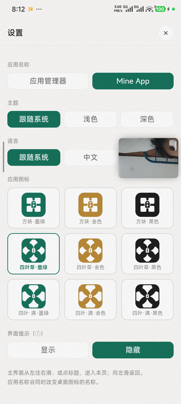
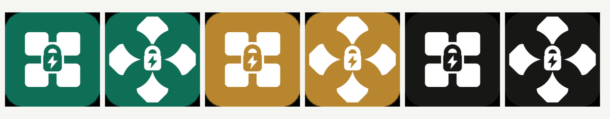

<p align="center">
  <b>简体中文</b> · <a href="README.en.md">English</a>
</p>

<p align="center">
  
</p>

<h1 align="center">Mine App · 应用管理器</h1>

<p align="center">
  
  
  
  
  
</p>

> **Mine App 是一款专为老旧与卡顿安卓设备注入第二春的纯净应用管理器。**
>
> - **真·零依赖**：无 Gradle 冗余，不依赖 Root，无需常驻 Shizuku，APK 体积不足 1MB，加上本地数据不足 10MB。
> - **逆向能效优化**：通过「归档冻结」与「后台限制」彻底封锁流氓进程与冗余唤醒；在常驻性能模式确保前台高响应的同时，大幅降低整机待机功耗。
> - **底层级加速**：原生支持 AOT Speed 全局静态预编译，消除 JIT 编译卡顿，显著压低应用冷启动延迟。

---

## 这是什么

Android 上想让不常用的应用「彻底别动」，常见办法是冻结。但主流方案要么要 root，要么要装
Shizuku / 冰箱 / 黑洞一整套。Mine App 换了个思路：

**手机自己连自己的 adbd。**

`adb tcpip 5555` 之后，adbd 会监听 `127.0.0.1:5555`。App 内置了一个精简的 ADB 客户端，
用 App 私有目录里的密钥完成认证，然后直接发 `pm` / `am` / `cmd` 命令——**全程不出本机，
不需要电脑，不需要 root**。

<p align="center">
  
</p>

### 和常见方案比

| | 需要 root | 需要常驻服务 | 需要电脑 | APK 体积 |
|---|---|---|---|---|
| 系统自带「强行停止」 | 否 | 否 | 否 | — （但重启后失效、不能批量） |
| Shizuku + 冰箱 | 否 | **是**（两个都要） | 首次要 | 数十 MB |
| **Mine App** | **否** | **否** | 仅首次 `adb tcpip` | **525 KB** |

## 功能

| 功能 | 说明 |
|---|---|
| **归档（冻结）** | `pm disable-user`，应用彻底不跑、不出现在最近任务，桌面图标变灰 |
| **限制** | 限制后台活动，比冻结温和，应用还能被拉起 |
| **AOT 编译** | `cmd package compile -m speed`，把 dex 提前编译成本地码，冷启动更快；带进度百分比 |
| **性能模式** | 一键切换系统性能档位，并在被系统回退后自动重新施加 |
| **内存排序** | 按 PSS 排序，一眼看出谁在吃内存；底部实时汇总已选应用的内存占用 |
| **批量操作** | 多选后一次归档 / 还原 / 限制 / 解限 |
| **常驻通知** | 状态栏常显电池健康、内存占用、归档数量 |
| **外观** | 6 套图标（方块 / 四叶草 × 墨绿 / 金 / 黑）、两种应用名、深浅主题、中英文 |
| **列表缓存** | 拉到的列表存本地，1 分钟内重进不重复拉取 |

<p align="center">
  
</p>

## 环境要求

- Android 8.0（API 26）及以上，targetSdk 35
- 开启开发者选项 → **USB 调试**
- 不需要 root

## 安装

1. 到 [Releases](https://github.com/henry-97/MineApp/releases) 下载 `app-manager.apk`（约 525 KB）
2. 或者自己编译（见下文「从源码构建」）

### 首次配置（关键的一步）

App 要连的是**本机 5555 端口的 adbd**，所以需要让 adbd 监听 TCP：

```bash
# 手机用数据线连一次电脑
adb tcpip 5555

# 拔线，之后每次手机重启都要重新执行一次（或用「无线调试」配对）
```

不想用电脑的话：设置 → 开发者选项 → **无线调试** → 开启后 App 也能连上。

首次打开 App 会在手机上弹出 ADB 授权框，勾选「一律允许」后永久生效。

## 从源码构建

不依赖 Gradle，也不依赖 Android Studio，只用 JDK + Android SDK build-tools + python3：

```bash
git clone https://github.com/henry-97/MineApp.git
cd MineApp/appmanager

cp local.env.example local.env     # 填上你的 SDK / JDK 路径
bash build.sh                      # 产物在 out/app-manager.apk
```

需要：

- JDK 17
- Android SDK：`build-tools;35.0.0`、`platforms;android-35`
- Python 3 + Pillow（生成图标用）

`build.sh` 首次运行会自动生成一个自签名密钥，不用自己准备。
所有路径都可以用环境变量覆盖，见 `build.sh` 顶部注释。

> 自己编译出来的 APK 签名和官方 Release 不同，**不能覆盖安装**官方版，需要先卸载。
> 反过来说，官方版也不可能被第三方用别的密钥覆盖——这正是发布密钥的意义。

## 项目结构

```
MineApp/
├── appmanager/                   Android 工程（无 Gradle）
│   ├── build.sh                  aapt2 → javac → d8 → zipalign → apksigner
│   ├── src/java/.../
│   │   ├── AdbClient.java        ADB 协议实现（CNXN/AUTH/OPEN/WRTE/OKAY/CLSE）
│   │   ├── AdbService.java       业务层：列表、归档、限制、AOT、电池、内存
│   │   ├── Bridge.java           JS ↔ Java 桥，单线程串行
│   │   ├── MainActivity.java     WebView 宿主
│   │   └── KeepAliveService.java 常驻通知
│   ├── res/                      资源（图标由 tools/gen_icon.py 生成）
│   ├── assets/                   打包进 APK 的前端
│   └── tools/
│       ├── gen_assets.py         从 server.py 提取前端 + 包名映射
│       ├── gen_icon.py           生成 6 套自适应图标
│       └── gen_manifest.py       生成 12 个 activity-alias
└── termux/
    └── webui/server.py           前端唯一真源（同时也是 Termux 版服务端）
```

**前端只有一份。** `server.py` 里内嵌了整个 HTML/CSS/JS，`gen_assets.py` 把它原样抽出来，
再注入一层 `fetch → Java 桥` 的 shim，所以 Termux 版和 APK 版的界面逻辑完全一致，
不存在两份实现需要同步。

## 已知限制

- **换图标/换名会把 App 进程带走**：Android 不能在运行时改 `label`/`icon`，只能靠切换
  `activity-alias` 实现；停用当前正在运行的那个 alias 时，任务会被系统结束。所以换完图标
  App 会重启一次（列表有缓存，重启后立刻恢复）。
- **手机重启后 5555 端口会关**，需要重新 `adb tcpip 5555` 或改用无线调试。
- **部分 ROM 的权限更严**：小米/红米需要先关掉安装二次确认
  （`adb shell settings put global adb_install_need_confirm 0`）。
- 归档应用后，桌面图标会变灰但不消失；想彻底隐藏需要 launcher 配合。

## 赞助

如果这个项目帮到了你，可以请我喝杯咖啡。**完全自愿，不影响任何功能。**

<div align="center">
  <table>
    <tr>
      <td align="center"><b>微信支付</b></td>
      <td align="center"><b>支付宝</b></td>
    </tr>
    <tr>
      <td></td>
      <td></td>
    </tr>
  </table>
</div>

也欢迎提 Issue 和 PR，那同样是很实在的支持。

## 开源协议

[GPL-3.0](LICENSE)。

简单说：你可以自由使用、修改、分发，但**分发时必须同样开源**，不能拿去加广告闭源再发布。
如果你需要把它用进闭源产品，可以开 Issue 谈授权。

## 免责声明

本项目通过 ADB 直接调用系统 `pm` / `am` / `cmd` 命令，**能力很强**。
冻结、限制系统应用可能导致闹钟不响、推送收不到、桌面异常等问题。
请只操作你自己清楚后果的应用，出问题请自行用 `adb shell pm enable <包名>` 恢复。
作者不对任何数据丢失或设备异常负责。
