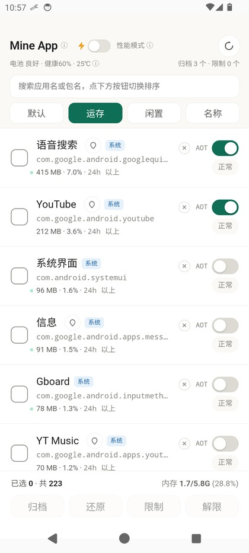
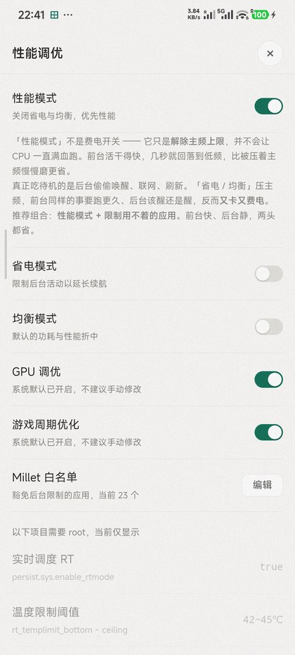
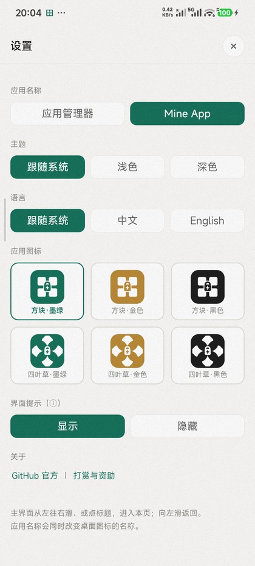
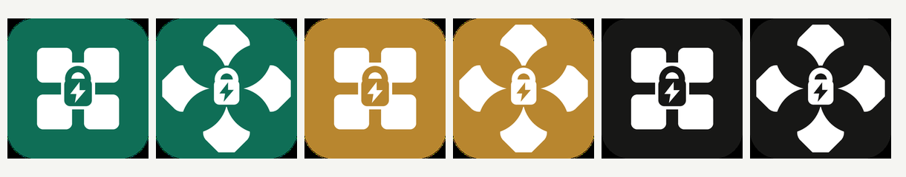

<p align="center">
  <b>简体中文</b> · <a href="README.en.md">English</a>
</p>

<p align="center">
  
</p>

<h1 align="center">Mine App · 应用管理器</h1>

<p align="center">
  
  
  
  
  
</p>

> **Mine App（中文名「应用管理器」）是一款专让卡顿安卓设备焕发活力的纯净应用管理器。**
>
> - **真·零依赖**：不引入 AndroidX 等任何第三方库，只用系统 API —— 全部代码编译后仅 **33 KB**，连同六套图标整体不足 1 MB，含本地数据总计不足 10 MB。构建侧也不依赖 Gradle，不依赖 Root，无需常驻 Shizuku。
> - **重启不丢限制**：**一次限制，永久生效**。归档与限制都写在系统状态里，**手机重启后依然生效**，不需要重新设置。重启后即使暂未 adb 授权，也只是暂时不能刷新显示应用列表，已经限制、归档过的应用不会因此放开；等你方便时再授权一次就能刷新列表，经常重启也不必顾虑。
> - **增效提速·降能耗**：通过「归档冻结」与「后台限制」彻底封锁流氓进程与冗余唤醒；在常驻性能模式确保前台高响应的同时，大幅降低整机待机功耗。**自身也几乎不耗电** —— 读内存走系统 API 不跑 shell，熄屏后刷新自动降到 60 秒一轮，后台 45 秒内零次 shell 调用。
> - **性能模式不费电**：它只解除 CPU 峰值主频上限，不会让 CPU 一直满血跑——前台任务干完就回落低频。真正吃掉待机的是后台偷偷唤醒，所以推荐「**性能模式 + 限制后台**」，比压主频的「均衡」更快也更省。
> - **底层级加速**：原生支持 AOT Speed 全局静态预编译，消除 JIT 编译卡顿，显著压低应用冷启动延迟。

---

## 这是什么

Android 上想让不常用的应用「彻底别动」，常见办法是冻结。但主流方案要么要 root，要么要装
Shizuku / 冰箱 / 黑洞一整套，**让本就有限的存储空间更加拥挤**。

Mine App 换了个思路 —— **在保持极致轻量的前提下，做到单 APP 部署**：

**手机自己连自己的 adbd。**

只要在**首次安装时**执行一次 `adb tcpip 5555`（数据线或「无线调试」都行，见下文 **首次配置**），
adbd 就会在本机 `127.0.0.1:5555` 上开一个入口。App 内置了一个精简的 ADB 客户端，
用自己私有目录里的密钥完成认证，之后直接发 `pm` / `am` / `cmd` 命令。
密钥存在私有目录，覆盖安装时原样保留 —— **所以软件更新后授权自动继承，无需再次 `adb`**。

**从此电脑就不用再管了** —— 归档、限制、AOT 预编译、性能档位，全部在手机屏幕上点几下完成，
不需要再碰 adb 工具。只要不重启手机，这一次 `adb tcpip` 就一直有效；重启后即使暂未授权，所有限制依然有效，
只是暂不能刷新应用列表，待方便时补执行一次授权，即可重新刷新应用列表，**所以即使经常重启手机，也无需担心授权失效**。

**装一个 App，就这一件事。** 不到 1 MB 的单个 APK，零第三方依赖：不装 Shizuku、不装冰箱、
不装黑洞，没有第三方守护进程，不申请多余权限 —— 只有一个常驻通知栏服务，用来显示电池和内存。

<p align="center">
  
</p>

### 数据刷新：压低自身负载，也不让信息变旧

常驻类工具最怕自己变成新的耗电源头。Mine App 的取数原则是「**能用系统 API 就不跑 shell，能少跑就少跑**」：

| 频率 | 取什么 | 怎么取 |
|---|---|---|
| **屏幕亮 3 秒 / 熄屏 60 秒** | 内存占用 | `ActivityManager.MemoryInfo` 系统 API，**不跑任何 shell 命令** |
| **屏幕亮 3 分钟 / 熄屏 30 分钟** | 电池健康、归档数、限制数、**墓碑补做** | `dumpsys battery` + `dumpsys batterystats` + 4 条 `pm` / `appops` + 1 条 `ps` + 批量 `am set-inactive` |

四点说明：

- **读内存改用系统 API**：早期版本是每 3 秒跑一次 `cat /proc/meminfo`，走 Shizuku / ADB 时等于每 3 秒 fork 一个进程 —— 这才是待机耗电的大头。现在读的是系统侧同一份数据，零进程开销。
- **频率跟着屏幕走，不看 App 在不在前台**：屏幕亮着时你随时可能下拉通知栏看数字，所以不管 App 在前台还是后台，内存都 3 秒刷一次；熄屏后没人看得到，降到 60 秒。
- **重活才低频**：电池健康、归档 / 限制统计要跑 `dumpsys` 和 `pm`，比读内存重得多，所以亮屏时 3 分钟才做一回，熄屏后 30 分钟一回。
- **墓碑补做跟全量刷新同一节拍**：`setAppInactive` 会被「用户主动打开应用」自动清除——也就是打开过一次，限制就失效了。所以每次全量刷新时，对**已限制且当前有进程**的应用重新打一次标记。实测通常 40 个左右，拼成一条 shell 批量执行约 2 秒；没进程的包直接跳过（对它们执行是纯浪费）。这里**没有独立定时器**，`FULL_GAP` 改成多少它就跟着多少，不会出现两处周期不一致。

点亮屏幕会立即补刷一次，不会看到熄屏前的旧数字。

**手动刷新按钮**除了重新拉列表，还会让通知栏的电池 / 归档 / 限制数字立刻也跟着刷新一次，不用等定时周期。

实测：后台 45 秒内的 shell 调用从 **15 次降到 0 次**。新增的墓碑补做让每天 CPU 时间从约 7 分钟增加到约 14 分钟，折算成整机电量约 **0.8%**。

主界面还留了**手动刷新按钮** —— 想立刻确认状态时点一下，不用等下一轮。

一句话：**高频只看最轻的指标，重活交给低频，熄屏几乎不干活。**

### 和常见方案比

| | **Mine App** | 系统「强行停止」 | 冰箱 Ice Box | 黑洞 Hail |
|---|---|---|---|---|
| 需要 root | **否** | 否 | 否 | 否 |
| 依赖 Shizuku | **否 ✓** | 否 | 是 | 是 |
| 自带 ADB 客户端 | **是 ✓** | — | 否（走 Shizuku） | 否（走 Shizuku） |
| 需要常驻后台服务 | **仅通知栏 ✓** | 否 | 是（Shizuku 常驻） | 是（Shizuku 常驻） |
| APK 体积 | **< 1MB ✓** | 系统自带 | 数 MB | 数 MB |
| 批量冻结 / 解冻 | **支持** | — | 支持 | 支持 |
| 冻结后重启仍有效 | **是** | 否 | 是 | 是 |
| 性能档位调优 | **支持 ✓** | — | — | — |
| 单应用 AOT 预编译 | **支持 ✓** | — | — | — |
| PSS 内存排序 | **支持 ✓** | — | — | — |

> **✓** 标出的是 Mine App 相对占优的项。
> 「自带 ADB 客户端」指应用自己实现了 ADB 协议（CNXN / AUTH / OPEN / WRTE），直接连手机本机的 adbd ——
> 所以不需要装 Shizuku 之类的外部工具，一次性授权后就能独立运行。
> 冰箱 / 黑洞两列依据其公开说明与常见用法整理，细节以各自文档为准。

## 功能

| 功能 | 说明 |
|---|---|
| **归档（冻结）** | `pm disable-user`，应用彻底不跑、不出现在最近任务，**桌面图标直接消失**（MIUI / HyperOS 不显示变灰态） |
| **限制** | `am set-inactive`（墓碑机制），后台进程被系统冻结；点开时**同一个进程原地复活**，状态不丢。比归档温和：应用照常打开使用，桌面图标也还在。部分高权限应用仍可能保留少量进程，见「已知限制」 |
| **进程明细**（5.0） | 多进程的应用会在时间后面标 `4进程 ›`，点开看它的每个进程：子进程名、累计 CPU 时间、内存、系统 oom 档位，以及哪个还在活动。应用双开 / 手机分身的进程标 `·多开`。**只在点开时查询，后台不刷新** |
| **应用查找**（3.8 起） | 点每行的定位按钮，就直接跳到该应用所在的桌面页并打开文件夹 —— 应用再多也能一眼找到。索引只需构建一次；没有索引或索引没建完时，列表上方会给出提示，点一下直达设置页补齐 |
| **白名单（免限制）** | 把应用加进系统的 doze / standby 白名单（`MILLET_NO_RESTRICT_APP`），系统不再按「长时间未使用」压制它的后台活动。**注意：这不等同于 MIUI 界面上的「省电策略 → 无限制」** —— 那个开关由 `com.miui.powerkeeper` 自己维护，写 settings 改不动，需要到应用信息页单独设置。名单内的应用会显示「白名单」胶囊并置顶；页底实时汇总已选应用的 PSS 合计 |
| **AOT 编译** | `cmd package compile -m speed`，把 dex 提前编译成本地码，冷启动更快；**可单应用针对性编译，也可批量**，编译时轨道内显示已用时。**状态自动识别**：重装或清数据后，会从系统 `dumpsys package dexopt` 批量读回哪些应用已经 AOT，界面照实显示，不用重新编译一遍 |
| **性能档位调优** | 一键切换系统性能档位，并在被系统回退后自动重新施加 |
| **内存排序** | 按 PSS 排序，一眼看出谁在吃内存；底部实时显示整机内存占用 |
| **活跃监测** | 还在跑的应用，内存行左侧点一个**呼吸绿点**（依据系统 oom 档位判断，只有纯缓存进程不算）。谁在偷偷活动一眼就能看出来 |
| **单应用清理** | 每行一个 **×**，走 `am force-stop` 把这个应用的**所有进程**停掉，连同最近任务卡片一起清（`am stack remove`）。点完标注立刻消失、整行 0.8 秒后移除，后台异步执行 |
| **应用名解析** | 批量读「启动项 label + 应用 label」两轮解析，全部应用都显示真实名称（含中文名），不是包名 |
| **批量操作** | 多选后一次归档 / 还原 / 限制 / 解限 |
| **常驻通知** | 状态栏常显电池健康、内存占用、归档数量；内存走系统 API 不跑 shell，亮屏 3 秒 / 熄屏 60 秒刷一次，电池与计数亮屏 3 分钟 / 熄屏 30 分钟取一次，待机几乎不耗电 |
| **外观** | 6 套图标（方块 / 四叶草 × 墨绿 / 金 / 黑）、两种应用名、深浅主题、中英文 |
| **列表缓存** | 拉到的列表存本地，1 分钟内重进不重复拉取 |

> **三个容易混的概念，一张表看清：**
>
> | 你在哪操作 | 实际改的是什么 | 管到哪一层 |
> |---|---|---|
> | 本应用 → **限制** | `am set-inactive`（墓碑），外加 `appops` 只作标记 | 后台进程被冻结；前台照常，点开即解冻 |
> | 本应用 → **白名单** | 系统 doze / standby 白名单（`EXEMPTED`） | 系统要不要压制它 |
> | MIUI 设置 → **省电策略** | `com.miui.powerkeeper` 的私有状态 | MIUI 自己的省电逻辑 |
>
> 前两个是两套独立状态，可以同时存在（一个应用可以既「已限制」又「在白名单」）。
> 但作用方向相反：**白名单放宽、限制收紧**，同时开时以更强的那个为准 —— 想让它后台跑就别加限制。
>
> 第三个我们写不进去 —— 想让 MIUI 界面也显示「无限制」，得去应用信息页手动选一次。

> **关于「性能模式」：它其实不费电**
>
> 「性能模式」听起来像个费电开关，其实相反——它只是**解除 CPU 的峰值主频上限**，
> 并不会让 CPU 一直满血跑。CPU 是按需调度的：前台任务几秒干完就回落到低频，
> 比被压着主频慢慢磨更省。
>
> 真正吃掉待机电量的，是**后台应用偷偷唤醒、联网、刷新**，不是峰值主频。
> 传统「省电 / 均衡」压主频，前台同样的事要跑更久，后台该醒还是醒——结果往往是
> **又卡又费电**。
>
> 所以推荐的是一个组合：
>
> | 动作 | 作用 |
> |---|---|
> | 打开**性能模式** | 放开主频上限，前台跑完就退，不拖时间 |
> | **限制**用不着的应用 | 让后台真正睡下去，砍掉唤醒 |
>
> 前台快、后台静，两头都省。

<p align="center">
  
</p>

<p align="center">
  
</p>

<p align="center">
  
</p>

<p align="center">
  <sub>支持多种自定义图标：内置 6 套（方块 / 四叶草 × 墨绿 / 金 / 黑），名称与图标都能在设置里随时切换；默认只显示前 3 套，点「展开」看全部。<br>
  后续会持续增加，也欢迎在开源社区 PR 贡献版权合规的图标。</sub>
</p>

## 环境要求

- Android 8.0（API 26）及以上，targetSdk 35
- 开启开发者选项 → **USB 调试**
- 不需要 root

## 安装

1. 到 [Releases](https://github.com/henry-97/MineApp/releases) 下载对应的 APK（约 650 KB）：
   经典版 `MineApp-X.Y.apk`、多通道版 `MineApp-X.Y-multi.apk`，两者的区别见下文「扩展版本」
2. 或者自己编译（见下文「从源码构建」）

### 首次配置（只做一次）

App 连的是**本机 5555 端口的 adbd**（同时也支持自定义其他端口），所以要先让 adbd 监听 TCP。这件事**只在首次安装时做一次**，
之后全在 App 里点按，不用再碰电脑。

**一次配置，永久生效**：之后在 App 里做的每一次归档和限制，都写进系统状态，**重启手机也不会失效**。
重启只是暂时读不到列表、不能新设应用限制，已经限制/归档的应用其限制/归档依然有效。

#### 路径 A：让 AI Agent 帮你配（零门槛，推荐新手）

不需要懂 adb，也不用敲任何命令 —— 把手机上的准备动作做完，剩下的交给任意 AI Agent
（ChatGPT / Claude / 通义 / 豆包 / Cursor 都行）。

**第 1 步：在手机上打开开发者选项和 USB 调试**

1. 设置 → 我的设备 → 全部参数与信息 → 连续点 **「OS 版本」7 次**，直到提示「已进入开发者模式」
2. 返回设置 → 更多设置 → **开发者选项** → 打开 **「USB 调试」**
3. 用数据线连电脑，手机弹出「允许 USB 调试吗？」→ 勾 **「一律允许使用这台计算机进行调试」** → 确定

**第 2 步：把下面这段话原样发给 AI Agent**

> 帮我在这台电脑上安装并配置 Mine App（安卓应用管理器）。
> 项目地址：<https://github.com/henry-97/MineApp>
>
> 请先读 README 的「首次配置」一节，然后依次完成：
> ① 确认 `adb devices` 能看到我的手机（没有 adb 就先装 platform-tools；装完命令还找不到就用全路径，或者按 README 里「先确认 adb 能用」加进 PATH）；
> ② 执行 `adb tcpip 5555`；
> ③ 从 Releases 下载最新的 APK，`adb install -r` 装上；
> ④ 在手机上打开 App，如果弹出 ADB 授权框，提醒我点「允许」；
> ⑤ 确认 App 能正常列出应用列表。
>
> 每一步执行前先说明你要做什么；遇到报错先诊断原因，不要让我手动敲命令。

Agent 会自己下载 platform-tools、跑 adb、装 APK。你只需要在手机上点两次「允许」。

**路径 B / C：手动安装其实也很方便 —— 配好 adb 之后，核心只有一条命令 `adb tcpip 5555`。**

#### 先确认 adb 能用（路径 B / C 都要这一步）

**情况一：`adb devices` 能列出设备** → 直接跑这一条就完事：

```bash
adb tcpip 5555
```

拔线 → 打开 App → 手机上勾「一律允许」→ 允许。

> 想自己一步步操作、或者没有数据线？看下面的 **路径 B**（有数据线）和 **路径 C**（无线调试），
> 那里有完整流程。也可以把整件事交给 AI Agent（**路径 A**）。

**情况二：报「不是内部或外部命令」/ `command not found`** → 没装，或者装了但没加进 PATH。
按下面的说明弄好，再回来跑上面那条命令。

**没装的话**：下载 Google 官方的 [platform-tools](https://developer.android.com/tools/releases/platform-tools)，
解压到一个固定目录 —— Windows 建议 `C:\platform-tools`，macOS / Linux 建议 `~/platform-tools`。

**装了但命令还是找不到**，把它加进 PATH：

```powershell
# Windows PowerShell —— 只对当前窗口有效，关掉就没了
$env:Path += ";C:\platform-tools"
adb devices
```

```bash
# macOS / Linux
export PATH="$HOME/platform-tools:$PATH"
adb devices
```

想永久生效（Windows，只改当前用户，不动系统级 PATH）：

```powershell
[Environment]::SetEnvironmentVariable("Path",
  [Environment]::GetEnvironmentVariable("Path","User") + ";C:\platform-tools", "User")
```

> 执行完必须**关掉终端重新打开**，已经开着的窗口不会生效。
> macOS / Linux 把那行 `export` 写进 `~/.zshrc` 或 `~/.bashrc` 即可。

**懒得改环境变量**也行，直接用全路径调用（Windows 下前面的 `&` 不能省）：

```powershell
& "C:\platform-tools\adb.exe" tcpip 5555
```

```bash
~/platform-tools/adb tcpip 5555
```

#### 路径 B：有数据线（自己敲一条命令）

```bash
# 1. 手机用数据线连电脑
adb tcpip 5555

# 2. 拔线。打开 App，手机上会弹 ADB 授权框 → 勾「一律允许」→ 允许
```

完事。

#### 路径 C：没有数据线（借电脑的「无线调试」跑那一条命令）

手机和电脑连**同一个 Wi-Fi**，然后：

```bash
# 1. 手机：设置 → 开发者选项 → 无线调试 → 「使用配对码配对设备」
#    屏幕上会显示 IP、配对端口、6 位配对码

# 2. 电脑：先配对（端口是「配对端口」，不是调试端口）
adb pair 192.168.1.23:37123
#    按提示输入 6 位配对码

# 3. 电脑：连上去（这次用「调试端口」，和配对端口不同）
adb connect 192.168.1.23:40555

# 4. 电脑：跑那一条关键命令
adb tcpip 5555

# 5. 手机上的无线调试现在可以关掉了 —— 关不关都不影响 App
```

之后打开 App，同样在手机上勾「一律允许」。

> **为什么不做「App 直连无线调试」？** 技术上可行，也能彻底摆脱电脑，但要重写整套配对与
> TLS 通信层，新增组件的体积会超过 App 本身，多机型适配的风险也不小 —— 与「极致轻量」的
> 初衷相悖。而相比「首次配置时跑一条 `adb` 命令」，它并没有明显优势，故暂不考虑此方案。

#### 手机重启后

5555 端口会关（`adb tcpip` 的效果不跨重启，`persist.adb.tcp.port` 非 root 写不了），
**补做一次上面任意一条路径**即可。App 会显示「调试通道未连接」并提示这条命令。

**但已经设置的限制和归档是永久的**：它们写在系统状态里，重启一次、十次都一样有效。
断掉的只是「读列表」这条通道 —— 不想马上补也没关系，等你方便时再补。

## 从源码构建

不依赖 Gradle，也不依赖 Android Studio，只用 JDK + Android SDK build-tools + python3：

```bash
git clone https://github.com/henry-97/MineApp.git
cd MineApp/appmanager

cp local.env.example local.env     # 填上你的 SDK / JDK 路径
bash build.sh                      # 产物在 out/app-manager.apk
```

需要：

- JDK 17
- Android SDK：`build-tools;35.0.0`、`platforms;android-35`
- Python 3 + Pillow（生成图标用）

`build.sh` 首次运行会自动生成一个自签名密钥，不用自己准备。
所有路径都可以用环境变量覆盖，见 `build.sh` 顶部注释。

> 自己编译出来的 APK 签名和官方 Release 不同，**不能覆盖安装**官方版，需要先卸载。
> 反过来说，官方版也不可能被第三方用别的密钥覆盖——这正是发布密钥的意义。

## 项目结构

```
MineApp/
├── appmanager/                   Android 工程（无 Gradle）
│   ├── build.sh                  aapt2 → javac → d8 → zipalign → apksigner
│   ├── src/java/.../
│   │   ├── AdbClient.java        ADB 协议实现（CNXN/AUTH/OPEN/WRTE/OKAY/CLSE）
│   │   ├── AdbService.java       业务层：列表、归档、限制、AOT、电池、内存、桌面索引
│   │   ├── A11yService.java      无障碍服务：桌面索引 / 应用查找
│   │   ├── Bridge.java           JS ↔ Java 桥，双线程池（普通 / 长任务分开）
│   │   ├── MainActivity.java     WebView 宿主
│   │   ├── OpHistory.java        操作历史（归档 / 还原 / 限制 / 解限）
│   │   └── KeepAliveService.java 常驻通知 + 墓碑补做
│   ├── res/                      资源（图标由 tools/gen_icon.py 生成）
│   ├── assets/                   打包进 APK 的前端（生成物，不要手改）
│   └── tools/
│       ├── gen_assets.py         从前端源文件抽取 HTML/CSS/JS + 包名映射
│       ├── gen_icon.py           生成 6 套自适应图标
│       └── gen_manifest.py       生成 12 个 activity-alias
├── termux/webui/
│   └── frontend.py               前端唯一真源（内嵌整个 HTML/CSS/JS）
├── ext-lsposed/                  LSPosed 模块源码（社区贡献，MIT，不参与本工程构建）
├── docs/                         各版本发布说明、图标与截图
└── dist/                         构建产物（APK）
```


> 本项目不需要提前装 Termux。`termux/` 这个目录名是历史遗留：早期提供过「Termux + Python 脚本免 root」的分发形态，
> 现在只作为前端源码的存放位置，不再随项目分发。

## 扩展版本：多通道授权版，独立发布 release APK

多通道版（其中引用了 GitHub 开发者 [MiaoluoYuanlina](https://github.com/MiaoluoYuanlina) 的
[仓库](https://github.com/MiaoluoYuanlina/MineApp-LSPosed) 中的部分内容）相比普通版，
在 App 内「设置 → 执行通道」会多出两个选项：

| 选项 | 说明 |
|---|---|
| ADB | 原版行为 |
| Root | 本应用申请 `su`，Magisk / KernelSU 的授权框里显示的是本应用 |
| Shizuku | 本应用以自己的身份申请 Shizuku 授权 |

走这两个通道就不必再执行 `adb tcpip 5555`，重启手机后也不会失效。

多通道版与普通版打同一个 tag，两个 APK 挂在同一个 Release 下；包名不同，互不覆盖。

引用说明：

- **关于第三方组件**：本仓库整体采用 GPL-3.0（见根目录 `LICENSE`）；而第三方组件是其作者的独立作品，
  使用第三方组件的内容请遵守其原始授权条款。第三方组件清单见 `THIRD-PARTY-NOTICES.md`。

## 已知限制

- **手机重启后 5555 端口会关**，需要重新执行一次 `adb tcpip 5555`。
  `persist.adb.tcp.port` 在非 root 下写不了（SELinux 拦 shell），所以没有免重启的办法。
  **但这不影响核心功能**：重启后即使一直不授权，已经设置的限制和归档**依然全部生效**；
  不授权只是读不到最新的应用列表、没法追加新的限制，等你方便时补一条命令即可。
- **AOT 全量编译很吃内存**：dex2oat 峰值可占到 2GB 以上，可用内存不足 2.5GB 时 App 会直接拦下并说明原因；
  极少数超大应用（插件 dex 极多，如抖音极速版）即使内存充足也可能被 dex2oat 放弃，状态会停在 `speed-profile`。
- 归档应用后，**桌面图标会直接消失**（实测 MIUI / HyperOS 不显示「变灰」的禁用态）。
  这是系统行为，不是被卸载 —— 在 App 里点「还原」就会回到桌面原来的位置。

- **「限制」从 4.9.3 起改用墓碑（App Inactive）机制**。
  旧版本用的是标准 AppOps 后台限制，但实测发现**部分国产 ROM 会直接忽略它**——
  设了 `RUN_IN_BACKGROUND=ignore` 之后应用后台照常运行（设满一整天，进程仍在、
  oomAdj 与未限制时完全一致）。所以改成 `am set-inactive`：后台进程会被系统冻结，
  点开时自动解冻、**同一个进程原地复活**，状态不丢。

  需要说明的是：**部分高权限应用仍可能保留少量进程**。本 App 只在低能耗前提下
  尽量维持限制状态——它们的后台活跃水平会显著低于未限制时，但不保证完全静止。

  **升级后旧限制名单里的应用会自动迁移到墓碑机制**，不需要重新限制一遍。
  迁移只做一次，之后无论升级到哪个版本都不会重复。

  如果某个应用被限制后无法正常使用（收不到消息、后台任务异常等），
  在 App 里点「解除限制」即可恢复 —— 冻结只作用于后台，不影响它正常打开和使用。

- **公共网络下别乱点「允许 USB 调试」**：`adb tcpip 5555` 会让 adbd 监听所有网卡，
  同网段的人能触发你的授权弹窗；误点「允许」等于把手机控制权交出去，可能导致资料泄露。
  来源不明的弹窗一律点「拒绝」。

<a id="sponsor"></a>

## 赞助

如果这个项目帮到了你，可以请我喝杯咖啡。**完全自愿，不影响任何功能。**

**推荐渠道：[GitHub Sponsors](https://github.com/sponsors/henry-97)** —— 按月或一次性都行，
支持记录公开、也方便我致谢。

也可以直接扫码：

<div align="center">
  <table>
    <tr>
      <td align="center"><b>微信支付</b></td>
      <td align="center"><b>支付宝</b></td>
    </tr>
    <tr>
      <td></td>
      <td></td>
    </tr>
  </table>
</div>

也欢迎提 Issue 和 PR，那同样是很实在的支持。

## 开源协议

[GPL-3.0](LICENSE)。

你可以自由使用、修改、分发，但**分发时必须同样开源，严禁拿去加广告闭源再发布**。
如果你需要把它用进闭源产品，可以开 Issue 谈授权。

## 使用须知

本软件通过 ADB 直接调用系统 `pm` / `am` / `cmd` 命令，**能力很强**。

请**不要随意冻结或限制系统必要组件**（时钟、桌面启动器、输入法、电话 / 短信等），
否则可能导致闹钟不响、桌面异常、收不到来电等问题。

**对系统应用施加「限制」、「归档」的风险未知**，请谨慎评估后再操作。

如果不慎误操作、且本软件已经无法打开，可以用数据线连电脑恢复：

```bash
# 限制后解限（一条命令：解冻 + 清标记）
adb shell "am set-inactive --user 0 <包名> false; cmd appops set <包名> RUN_IN_BACKGROUND allow"

# 归档后还原（一条命令：两种归档方式一起尝试还原）
adb shell "pm enable <包名>; cmd package install-existing <包名>"
```

> **解限为什么要清两层**：`am set-inactive` 是真正生效的那层（解除冻结），
> `cmd appops` 是索引层——本 App 靠 `appops query-op` 一条命令查出所有被限制的应用。
> 只解冻不清标记的话，应用会一直留在「一键解除」的名单里。
>
> **还原为什么两条都跑**：`pm disable-user` 直接禁用，用 `pm enable` 还原；
> 系统应用不允许禁用时会退回 `pm uninstall --user 0` 只移除当前用户（APK 仍在系统分区），
> 这种只能用 `cmd package install-existing`。两条一起跑覆盖两种情况。

**一键还原所有归档**：

```bash
adb shell 'pm list packages -d | sed "s/package://" | while read p; do pm enable $p; done; pm list packages -u --user 0 | sed "s/package://" | sort > /data/local/tmp/aa.txt; pm list packages --user 0 | sed "s/package://" | sort > /data/local/tmp/bb.txt; comm -23 /data/local/tmp/aa.txt /data/local/tmp/bb.txt | while read p; do cmd package install-existing $p; done; rm -f /data/local/tmp/aa.txt /data/local/tmp/bb.txt'
```

**一键解除所有限制**：

```bash
adb shell 'cmd appops query-op RUN_IN_BACKGROUND ignore | while read p; do am set-inactive --user 0 $p false; cmd appops set $p RUN_IN_BACKGROUND allow; done'
```

> 上面两条用单引号包裹，PowerShell / macOS / Linux / Git Bash 可直接使用。
> Windows CMD 请把外层单引号换成双引号。

**因使用不当造成的数据丢失或设备异常，作者不承担责任。**
